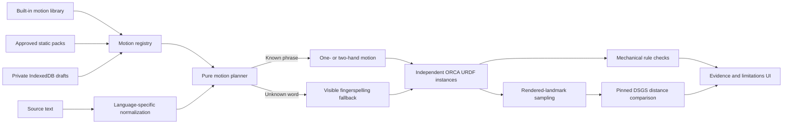

# Architecture

ORCA Hand Sign Lab is a static, local-first React application. It has no API,
server database, authentication, analytics, or runtime AI service. Optional
Sign Pack drafts use IndexedDB only after an explicit save action.

## Runtime flow



The planner never labels its output certified translation. Mechanical evidence
only proves the scope stated by each check. Comprehension, grammar, timing,
signing space, and nonmanual features require Deaf signer review.

## Feature boundaries

| Area                                          | Responsibility                                                                       |
| --------------------------------------------- | ------------------------------------------------------------------------------------ |
| `src/demo/SignDemo.tsx`                       | Composes text state, planner, playback, evidence, and viewer features                |
| `src/demo/components/SourcePlanPanel.tsx`     | Language, source text, generated plan, and playback controls                         |
| `src/demo/components/MotionEvidencePanel.tsx` | Lexical sources, geometry results, limitations, and DSGS measurements                |
| `src/demo/components/HandViewer.tsx`          | 3D scene plus camera, hand-mode, manual-pose, and near-hand playback controls        |
| `src/demo/components/HandModel.tsx`           | One URDF instance, animation lifecycle, and rendered landmark capture                |
| `src/demo/three/handModelScene.ts`            | Pose application, materials, disposal, landmark reads, and camera fitting            |
| `src/demo/hooks/usePlaybackController.ts`     | Cursor, timing, manual poses, and safe hand-mode transitions                         |
| `src/demo/hooks/useSignPackRegistry.ts`       | Lazy merge of approved and browser-local packs                                       |
| `src/demo/domain/*`                           | Pure planning, motion data, reference diagnostics, and comparison algorithms         |
| `src/signpacks/domain/signPackSchema.ts`      | Ajv compilation of the portable JSON Schema authority                                |
| `src/signpacks/domain/signPack.ts`            | Semantic validation, serialization, motion construction, and planner compilation     |
| `src/signpacks/domain/signPackEditor.ts`      | Pure editor-to-pack and pack-to-editor transforms                                    |
| `src/signpacks/storage/signPackStore.ts`      | The only IndexedDB access boundary                                                   |
| `src/signpacks/components/*`                  | Metadata, preview, motion editing, private drafts, export, and clipboard preparation |
| `public/signpacks/index.json`                 | Reviewed static registry loaded at runtime                                           |
| `schemas/signpack.v1.schema.json`             | Browser/CLI/fixture/CI interchange contract                                          |

`App.tsx` lazy-loads the lab, Contributor Studio, and About page. The optional
Ajv validator and IndexedDB code are not part of the initial route.

## Trust and data boundaries

- Text input is capped at 600 characters, held in React state, and never sent.
- Uploaded text is sliced before reading and is never transmitted or persisted.
- A Sign Pack excludes contributor identity and source recordings by design.
- `personal-draft` is the only trust state a browser author can create.
- Maintainers may promote a reviewed pack, but mechanical checks cannot promote
  it to `signer-verified` without documented qualified review.
- Unrecognized words degrade visibly to letters; broken sources never silently
  become verified output.

## Verification boundary

```bash
npm run verify
npm run test:e2e
```

The first command covers deterministic and repository-level contracts. The
second covers rendered desktop/mobile behavior. Neither proves deployment
freshness or linguistic correctness. Those require a live-URL check and Deaf
signer review respectively.

The external DSGS toolchain, pinned inputs, and metric calibration are described
in [validation/README.md](validation/README.md).
