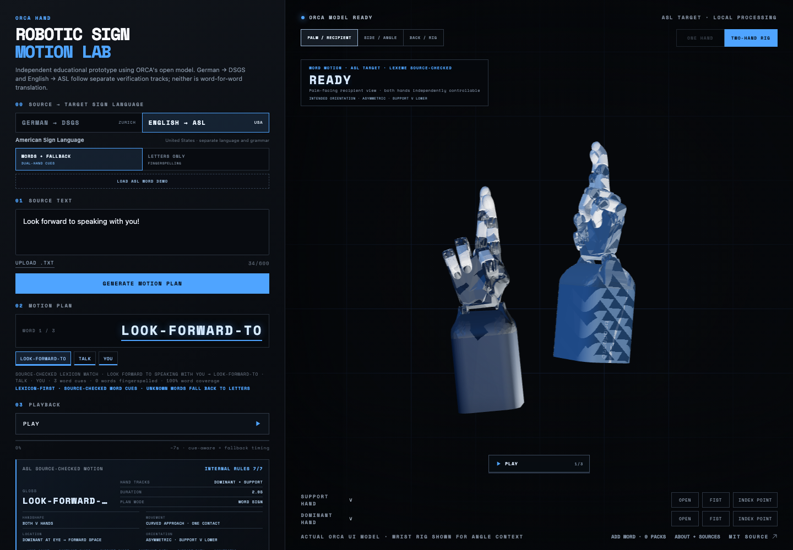

# ORCA Hand Sign Lab

[](LICENSE)

An independent, local-first browser prototype exploring how the open
[ORCA Hand](https://www.orcahand.com/) model can render inspectable one- and
two-hand motion cues.

A learning project about robotic hand models, motion planning, and the limits of
hand-only sign representation. Start with [what I learned](docs/LEARNING.md),
then reproduce a motion cue or build a local Sign Pack.

**[Try the browser demo](https://orca-sign-lab.vercel.app/)** ·
**[Explore the source](https://github.com/Devpen787/orca-sign-lab)**

Feedback welcome: where does a motion cue become unclear or misleading? Include
the phrase, language track, device/browser and expected behavior in a GitHub issue.
Sign-language feedback from fluent signers is especially valuable; this prototype
does not establish linguistic correctness.



## Five-minute review

1. Keep **English → ASL** and **Words + fallback** selected.
2. Generate “Look forward to speaking with you!” and replay it beside the hands.
3. Inspect palm, side, and rear views. Two-hand cues cannot be collapsed into an
   invalid one-hand preview.
4. Enter a new phrase. Known source phrases use explicit motion cues; unknown
   words visibly fall back to fingerspelling.
5. Open **Add Word** to create a private Sign Pack, preview it, save it to
   IndexedDB, reload it, and export it without an account or backend.

## What it demonstrates

- Separate English-to-ASL and German-to-DSGS tracks.
- Source-backed lexical motion cues with visible phrase-composition limits.
- Coordinated playback using two independent ORCA URDF instances.
- Recipient, side-angle, and rig-inspection perspectives.
- Explicit fingerspelling fallback instead of invented word signs.
- Mechanical rule checks for hand use, encoded handshape, path, relationship,
  and source presence.
- A source-pinned DSGS lane that samples the rendered ORCA landmarks and reports
  unbenchmarked handshape, motion, and hand-use distances.
- A local-first Sign Pack Contributor Studio with one schema shared by the
  browser, command line, fixtures, and CI.
- No accounts, backend, analytics, telemetry, or external AI service.

## What it does not claim

This is not fluent or certified ASL/DSGS translation. Hand geometry cannot
represent facial grammar, body position, full signing space, timing nuance, or
community comprehension on its own. A Deaf signer fluent in the target language
must review the rendered output before any linguistic verification claim.

The interface therefore distinguishes **source-backed**, **mechanically
checked**, **signer verified**, and **unsupported** evidence.

## Local development

Requirements: Node 22.12 or newer within Node 22–24, and npm.

```bash
npm ci
npm run dev
```

Vite prints the local URL. Use `#studio` for the Contributor Studio and `#about`
for the product intent, sources, and limitations.

## Quality contract

```bash
npm run verify
npm run test:e2e
```

`verify` enforces formatting, lint, TypeScript, the repository contract, privacy
patterns, the shared Sign Pack schema, unit tests, a production build, and gzip
bundle budgets. Playwright separately exercises desktop and mobile user journeys,
responsive layout contracts, locally reviewed platform screenshots, local
persistence, and serious/critical accessibility findings.

## Architecture

The app uses React, TypeScript, Vite, Three.js, React Three Fiber, `urdf-loader`,
IndexedDB, JSON Schema/Ajv, Vitest, Playwright, and axe-core. Routes and optional
Sign Pack tooling are loaded on demand.

- [Architecture and runtime boundaries](ARCHITECTURE.md)
- [Validation and evidence model](docs/VALIDATION.md)
- [Privacy model](docs/PRIVACY.md)
- [Contributor guide](CONTRIBUTING.md)
- [Release procedure](docs/RELEASE.md)
- [Third-party sources and licenses](THIRD_PARTY_NOTICES.md)

## Attribution

The hand URDF, meshes, and loader foundation are derived from ORCA Dexterity's
[`orca_ui`](https://github.com/orcahand/orca_ui) under the MIT License.
Machine-readable fingerspelling reference geometry is derived from
[ZurichNLP's spoken-to-signed translation resources](https://github.com/sign-language-processing/spoken-to-signed-translation),
also under the MIT License. Four DSGS traces are exported from hash-verified
`.pose` files at the pinned revision recorded in
[THIRD_PARTY_NOTICES.md](THIRD_PARTY_NOTICES.md).

## Privacy

The repository intentionally excludes application materials, recordings,
private messages, email addresses, analytics identifiers, runtime secrets, and
user account data. Typed source text remains in memory. A Sign Pack reaches
browser IndexedDB only after **Save Local Draft** and leaves the browser only
through another explicit export or contribution action.
